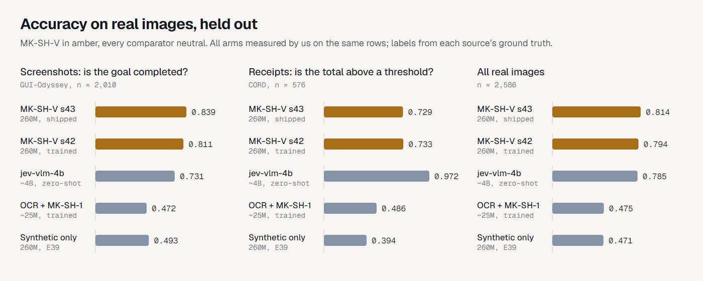
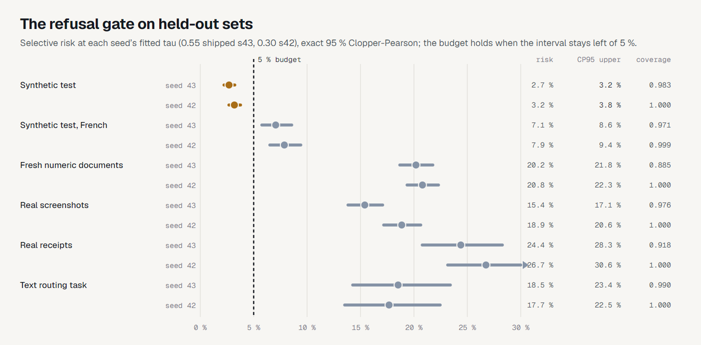

<!-- Local mirror of the Hugging Face model card (pushed as README.md by scripts/push_hf.py). -->

<table><tr>
<td></td>
<td><h1>MK-SH-V</h1><p><sub>a 260M visual decision model: calibrated probabilities, a choice, and a refusal below the gate</sub></p></td>
</tr></table>

A decision model of about 260M parameters that answers typed questions over
a described state **and an image**: given an image (a document page or a
mobile or desktop screenshot), a state, a question and a list of options, it returns
calibrated probabilities, a choice, and an explicit abstention when
confidence is insufficient. One single tower reads pixels and text in the
same pass; each option is marked inline and scored by a shared head. Its
differentiating capability is measured abstention: a decision threshold
whose selective risk was validated on held-out data with exact
Clopper-Pearson bounds, under criteria frozen before any measurement.

The published weights are the E47 seed-43 checkpoint (`model.safetensors`,
sha256 `ff4a4759…`, exported from `best.pt` sha256 `afcbeaa4…`, best step
800). E47 is the last of four fine-tunes of the E41 release checkpoint for
printed numbers (E44 to E47); E48 confirmed the numeric result on 3,000 fresh
documents and refitted the calibration and the gate by the E42 protocol,
without touching a weight. Seed 42 (`8b166fb9…`) was trained and evaluated
the same way and is reported alongside as the replication; it is not part of
this upload. `inference-policy.json` carries the full policy for this
checkpoint: the temperature, the gate, the response semantics and the input
rule (images under 1,024 px on the longest side are enlarged to it, as in
training).

Why seed 43: seed 42's fitted gate is τ = 0.30, the bottom of the grid, so it
never refuses a two-option question. Seed 43 (τ = 0.55) keeps a working gate.
The choice rests on that calibration-split property, not on held-out accuracy.

Interactive demo: [Gjusev/MK-SH-V-demo](https://huggingface.co/spaces/Gjusev/MK-SH-V-demo)
(Gradio, CPU). Twelve cases decide in one click: documents, receipts and
screenshots across English, Spanish and German, every answer checked against
gold, with one refusal and one confident wrong answer kept and labelled as
failures. Or upload your own. Code, criteria and per-case results:
[github.com/Gjusev/mk-sh-v](https://github.com/Gjusev/mk-sh-v).

## What it is for

Each case names the measured capability it rests on, and where that
measurement stops. Pairs of numbers are seed 43 (shipped) then seed 42.

1. **End-of-task screen detection and document decisions.** "Does this
   screenshot show the goal as completed", document type and form state,
   urgency of a ticket shown on screen. Rests on real-image accuracy
   0.814/0.794 on 2,586 held-out cases (CORD receipts + GUI-Odyssey
   screenshots): on GUI-Odyssey task completion the 260M model reaches
   0.839/0.811 against 0.731 for a zero-shot ~4B comparator and 0.472 for an
   OCR pipeline. Bound, from the goal-swap diagnostic (each final screenshot
   paired with an unrelated goal): the model rejects the wrong goal
   0.775/0.785 of the time, up from 0.12/0.135 in E41 but under the 0.80
   bar frozen for a goal claim. Use it as end-of-task screen detection, not
   goal verification.
2. **Printed numeric thresholds, with a ceiling.** "Is the total at least X":
   0.718/0.725 on the synthetic test, 0.737/0.760 on 3,000 fresh documents
   generated after the criteria were frozen (E48/E53), 0.729/0.733 on real CORD
   receipts against a deterministic rules baseline at 0.594 and the large
   comparator at 0.972. Bound: fine gaps under 1 % between total and
   threshold remain the hard part; the fresh set shares the five test
   templates (fresh in content, totals and thresholds, not in layout); the
   gate is not validated for this family.
3. **Calibrated probabilities with a safety valve.** Temperature T and
   gate τ fitted on calibration splits disjoint from every reported set
   (E53, on the E52 checkpoints): on the held-out synthetic test, the shipped
   checkpoint answers 98.3 % of cases with a 95 % Clopper-Pearson upper bound
   on selective risk of 3.23 % (seed 42: 100 %, 3.77 %; budget 5 %). Suited to decision queues
   where refusals go to human review. Bound: that guarantee is protocol- and
   distribution-specific (our synthetic families). On real screenshots the
   gate keeps 97 % of cases while 16 % of kept answers are wrong; on real
   receipts it keeps 89 % with 25 % wrong. No abstention claim is made
   beyond the evaluated protocol.
4. **Mixed text and visual decision queues.** Text competence is retained
   through replay-mixing: 1.000/1.000 on the MK-SH-1 numeric order set
   (testC, MK-SH-1 itself 0.979) and 0.830/0.833 on the routing task set
   (MK-SH-1 0.800). Bound: descriptive only; the shipped policy was fitted
   on the visual calibration split, and task-set selective risk is 17 %.
5. **A methodological template.** Twelve experiments (E37 to E48) with
   criteria frozen and committed before each measurement, per-case outputs
   for every number, episode-grouped statistics, and published failure
   modes. Bound: one architecture, two real sources, 260M scale; not claimed
   beyond what the campaign measured.

## Measured capability



Real images, held-out 2,586 cases (labels from each source's ground truth;
details and provenance in the training repo):

| Arm | Params | Real overall | CORD thresholds | GUI task done | Regime |
|---|---|---|---|---|---|
| **MK-SH-V s43 (shipped)** | **260M** | **0.814** | 0.729 | **0.839** | task-trained |
| **MK-SH-V s42** | **260M** | **0.794** | 0.733 | **0.811** | task-trained |
| jev-vlm-4b | ~4B | 0.785 | 0.972 | 0.731 | zero-shot |
| OCR → MK-SH-1 | ~25M | 0.475 | 0.486 | 0.472 | task-trained |
| Same model, synthetic-only training | 260M | 0.471 | 0.394 | 0.493 | task-trained |

Overall the shipped model is level with the ~15× larger zero-shot
comparator; no paired test was run for this checkpoint, so read it as a tie.
That comparator may have seen the evaluation sources in pretraining;
unverifiable from its card. Lineage: adding real CC-BY data (E41) moved real
accuracy by +29.4 pp over synthetic-only training (CI95 [+25.9, +32.9], seed
42, paired by episode); the numeric fine-tunes then took real receipts from
0.550/0.602 (E41, s42/s43) to 0.734.

Synthetic held-out test (own generator, 7 families, 4,200 cases):
0.959/0.959, against 0.908/0.909 for the E41 release. Per family (seed 42,
no abstention): doc_type, form_complete, screen_state, source_conflict,
task_done and urgency 0.995 to 1.000; field_threshold 0.725. French test
0.930/0.919.

## Calibration & abstention (experiment E48, E42 protocol)



Protocol, frozen before any measurement: T fitted by NLL on
`cal_temperature` (3,150 synthetic calibration cases); τ chosen on a
separate `cal_policy` split (3,150) as the smallest grid value whose
Clopper-Pearson 95 % upper bound on selective risk stays within the 5 %
budget; held-out sets reported with exact two-sided CP intervals, budget on
the upper end. Unlike an in-sample policy, every reported number below is
out-of-sample for both T and τ.

> On our held-out synthetic evaluation, both 260M checkpoints answered at
> least 98.3 % of cases while maintaining a 95 % Clopper-Pearson upper
> confidence bound on selective risk below 5 % (3.23 % and 3.77 %).

Three real cases through these weights and this policy:

| Input | Question | Calibrated probabilities | Output |
|---|---|---|---|
|  | Does the screenshot show the goal as completed? | true **0.998**, false 0.002 | **choice: true** |
|  | Is the total on this document at least 45.662 IDR? | true **0.978**, false 0.022 | **choice: true** |
|  | Which range does the total fall into? (below 100.000, 100.000 to 200.000, above 200.000 IDR) | low **0.757**, the other two 0.243 together | **choice: low**, wrong |

The receipt's total is 302.016 IDR. The E41 release refused the second
question at 0.507; this checkpoint reads the total and answers it. The third
row is a confident error that clears the gate, the kind the real-receipt row
below counts.

| Set | n | Coverage | Selective risk | 95 % interval | Budget |
|---|---|---|---|---|---|
| s43 synthetic test (non-FR) | 4,200 | 0.983 | 2.69 % | 2.2 to 3.2 % | **held** |
| s42 synthetic test (non-FR) | 4,200 | 1.000 | 4.14 % | 3.6 to 4.8 % | **held** |
| s43 synthetic test FR | 1,400 | 0.962 | 5.42 % | 4.3 to 6.8 % | missed |
| s42 synthetic test FR | 1,400 | 0.999 | 8.08 % | 6.7 to 9.6 % | missed |
| s43 fresh numeric documents | 3,000 | 0.876 | 22.9 % | 21.3 to 24.6 % | missed |
| s43 real GUI | 2,010 | 0.973 | 16.1 % | 14.5 to 17.8 % | missed |
| s42 real GUI | 2,010 | 1.000 | 20.0 % | 18.2 to 21.8 % | missed |
| s43 real CORD | 576 | 0.892 | 25.3 % | 21.6 to 29.3 % | missed |
| s42 real CORD | 576 | 1.000 | 26.6 % | 23.0 to 30.4 % | missed |
| s43/s42 text testC | 48 | 1.000 | 0 % | 0 to 7.4 % | n too small |
| s43/s42 text task | 300 | 0.993/1.000 | 16.8/16.7 % | 12.6 to 21.5 % | missed |

T = 1.124 (s43) and 1.4653 (s42); τ = 0.55 (s43) and 0.30 (s42). The full
risk/coverage curves per set and family are in the training repo
(`runs/e48/`, deterministically regenerable). ECE after T (s43): synthetic
test 0.007, real GUI 0.10, real CORD 0.06. The confidence signal that works
on the synthetic distribution does not yet separate right from wrong on real
images: that is the campaign's declared open problem, not a hidden one. A
screens-domain gate (E43, on the E41 checkpoint) held the budget on one seed
and missed on the other, so no real-GUI abstention claim is made.

## Two-seed ensemble option (experiment E51)

Publishing the second trained seed (`model-s42.safetensors`, sha
`0ddd1aef...`) unlocks an ensemble policy: average the two members' raw
option probabilities, then apply T = 0.8329 and the gate at tau = 0.30
(`inference-policy-ensemble.json`, same frozen E42 fit protocol on the
ensemble's own calibration split). Held out, the ensemble beat the E47 single seed on every one of the seven
evaluation sets and holds the 5 % budget on the synthetic test (CP95 upper
4.23 % at coverage 1.00). The E52 pair was also measured as an ensemble
(E53 per-case refit): the single E52-s43 beats it on every held-out set, so
no E52-pair ensemble ships; the members of this policy are kept as
model-e47-s43/s42.safetensors. It costs two
forward passes per case. The real-screens abstention gap is NOT solved by
ensembling: E51 measured the screens gate still not claimable (budget met
only at 24 % coverage, under the pre-registered 30 % floor), and a uniform
weight-average "soup" of the two seeds preserved every decision but
destroyed the probability ranking (smoke-killed). The hosted demo keeps the
single-seed policy; the Amber Checkpoint in-game audit is bound to it.

## Usage

```bash
pip install "mksh-v @ git+https://github.com/Gjusev/mk-sh-v"
```

```python
import json, torch
from PIL import Image
from huggingface_hub import hf_hub_download
from safetensors.torch import load_file
from mokka_decisions.contracts import DecisionCase, Option
from mksh_v.arch_a1v import NeoMMEMarkerScorer, forward_a1v

repo = "Gjusev/MK-SH-V"
policy = json.load(open(hf_hub_download(repo, "inference-policy.json")))
T = policy["temperature"]["value"]        # fitted on cal_temperature (E48)
tau = policy["abstention"]["threshold"]   # fitted on cal_policy (E48), CP-upper rule

model = NeoMMEMarkerScorer()              # Hcompany/NeoMME-260M backbone, marker head
model.ensure_markers(32)
model.load_state_dict(load_file(hf_hub_download(repo, "model.safetensors")), strict=True)
model.eval()

case = DecisionCase(
    id="q1", group_id="q1", source="me", language="en", domain="screens",
    state="Goal: print orders_nov.csv for the records",
    question="Does the screenshot show the goal as completed?",
    options=(Option(id="false", description="No"), Option(id="true", description="Yes")))
enc = model.encode_cases([case], max_state_tokens=700, max_option_tokens=96)
batch = model.build_batch(enc, [Image.open("screenshot.png").convert("RGB")], "cpu",
                          max_side=1024, upscale_to=1024)   # policy["input_rule"]
with torch.inference_mode():
    probs = (forward_a1v(model, batch) / T).softmax(-1)[0].tolist()   # calibrated
top = max(range(len(probs)), key=probs.__getitem__)
choice = case.options[top].id if probs[top] >= tau else None   # None = below_validated_threshold
```

About one second per decision on a laptop CPU. Leaving out `upscale_to`
feeds the model smaller images than it was trained and calibrated on, and T
and τ no longer apply.

## Provenance of this release

E52 training (criteria frozen before generation): 12,000 receipt-format rows
(own thermal renders; IDR dot-thousands, comma decimals, 4-8-digit totals)
added to the E47 pool, both seeds 800 steps, init from the E47 checkpoints.
E53 recalibration (E42 protocol verbatim): T 1.4011, gate tau 0.55, CP95
upper 3.23 % at 98.3 % coverage on the held-out synthetic test. Release
decision rule R3 was pre-registered and passed on the raw-accuracy convention
(all-real 0.8144 vs the previous 0.807).

## Architecture

`NeoMMEMarkerScorer`: single NeoMME-260M tower (Hcompany, Apache-2.0),
fine-tuned with a marker head. Sequence layout per case:
`<doc> image-patch-grid state <eos> question [O0] option_0 [O1] option_1 …`;
each option is marked by a learned inline marker token, the shared head
scores every marker in one pass, and the softmax runs over the valid
options only. It is not a chat model and generates no text.

## Training / calibration provenance

Weights: E41 seeds 42/43 (initialised from the E37 C3 checkpoint, 2,000
steps, effective batch 32, E35 text replay and real images from CORD train
receipts and GUI-Odyssey task_split train episodes), then four fine-tunes of
800 steps each, every one starting from the previous checkpoint (sha
verified): E44 and E45 add numeric and goal "bind" questions on train
images, E46 enlarges every image to 1,024 px before the encoder, E47
regenerates the digit-reading questions. Slots per step cycle through
synthetic, E41 real, bind and text replay; selection on dev splits only.
Calibration + policy: experiment **E48** (criteria frozen before the fresh
set was generated; E42 protocol unchanged). Full record:
[github.com/Gjusev/mk-sh-v](https://github.com/Gjusev/mk-sh-v)
(`docs/E37…E48 criteria`, per-case files under `runs/`).

## Limitations (declared)

- Abstention is validated on the synthetic protocol only; on real images the
  gate keeps most cases while 16 to 25 % of the kept answers are wrong. A
  screens-domain gate (E43) held the budget on one seed and missed on the
  other, so the claim rule fails; per-domain thresholds or an OOD signal
  remain open work.
- Goal grounding on screenshots is partial: paired with an unrelated goal,
  the model still says the goal is done about 22 % of the time (E47
  goal-swap, 0.775/0.785 against a 0.80 bar). The measured capability is
  end-of-task screen detection.
- Printed numeric thresholds hold at 0.72 to 0.76 in distribution and 0.734
  on real receipts; gaps under 1 % between total and threshold are the hard
  part, and the gate is not validated there.
- French is evaluated but not claimable for abstention (CP95 upper above 5 %
  on both seeds).
- The real evaluation set (E38c) informed the error analysis that motivated
  the training data; it was never trained or tuned on, and all selection
  used separate dev splits. Disclosed for completeness.
- Single global temperature per checkpoint; text-set probabilities inherit
  a policy fitted on the visual calibration split (reported descriptively).
- 48-case text set cannot certify a ≤5 % CP upper bound even at zero errors.

## Attribution

- Backbone: [NeoMME-260M](https://huggingface.co/Hcompany/NeoMME-260M)
  (Hcompany), Apache-2.0, fine-tuned by this project.
- Training data: CORD v2 train (Park et al. 2019, NAVER Clova, CC BY 4.0);
  GUI-Odyssey task_split train (Lu et al. 2024, OpenGVLab, CC BY 4.0);
  evaluation counterparts from the same sources' held-out splits. Original
  bytes, no re-encoding; labels derived from each source's ground truth
  with rules committed before generation.
- Text replay mix and comparators: this project's MK-SH-1 (Apache-2.0);
  jev-vlm-4b (used zero-shot for evaluation only).

## Previous release

The E41 seed-42 checkpoint with the E42 policy. Its launch film carries that
release's numbers:
[mkshv-film.mp4](https://huggingface.co/Gjusev/MK-SH-V/resolve/main/assets/mkshv-film.mp4).

## License

Apache-2.0 (code and trained weights of this export). CC-BY-4.0 sources
keep their attribution obligations, documented in
`THIRD_PARTY_NOTICES.md`.
