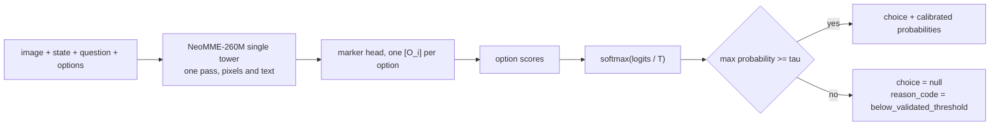

<table><tr>
<td></td>
<td><h1>MK-SH-V</h1><p><sub>a 260M visual decision model: calibrated probabilities, a choice, and a refusal below the gate</sub></p></td>
</tr></table>

A small open **visual decision model**. Give it a document page or a
screenshot, a question and the options; it returns calibrated probabilities
and a choice, or it refuses when its confidence sits below a gate whose risk
was validated on held-out data. The visual sibling of
[MK-SH-1](https://github.com/Gjusev/MK-SH-1).

<p align="center">
  <a href="https://huggingface.co/Gjusev/MK-SH-V"><b>Model</b></a> ·
  <a href="https://huggingface.co/spaces/Gjusev/MK-SH-V-demo"><b>Live demo</b></a> ·
  <a href="#use-it"><b>Use it</b></a> ·
  <a href="#measured-against-the-field"><b>Results</b></a> ·
  <a href="https://github.com/Gjusev/MK-SH-1"><b>MK-SH-1</b></a>
</p>

| 0.839 | τ = 0.55 | 98.3 % |
|:---|:---|:---|
| accuracy on real screenshots, held out; a ~15× larger model run zero-shot scores 0.731 | the refusal gate, fitted on a calibration split by a rule frozen in advance | answered on the held-out synthetic test, with a 95 % Clopper-Pearson risk bound of 3.2 % |

## What it does

Three real cases, run through the released weights and the shipped policy:

| Input | Question | Calibrated probabilities | Output |
|---|---|---|---|
|  | Does the screenshot show the goal as completed? | true **0.998**, false 0.002 | **choice: true** |
|  | Is the total on this document at least 45.662 IDR? | true **0.978**, false 0.022 | **choice: true** |
|  | Which range does the total fall into? (below 100.000, 100.000 to 200.000, above 200.000 IDR) | low **0.757**, the other two 0.243 together | **choice: low**, wrong |

The receipt's total is 302.016 IDR. The E41 release refused the second
question at 0.507; this one reads the total and answers it. The third row is
where it stops: the right range is "above 200.000", and the model picked
"below 100.000" with a confidence that clears the gate. On real receipts
about a quarter of the answers the gate lets through are wrong (see [the gate,
held out](#the-refusal-gate-held-out)); the gate's risk budget is validated
on the synthetic test only.

How a decision is made: one encoder pass reads the image and the text
together, each option is marked inline and scored by a shared head, and the
softmax runs over the valid options only. The temperature T only rescales
confidence, so it never changes a choice. The gate tau was fitted on a
calibration split (E48, by the E42 protocol) as the smallest threshold whose
Clopper-Pearson 95 % upper bound on selective risk stays within a 5 % budget.
Images whose longest side is under 1,024 px are first enlarged to it
(Lanczos), exactly as in training and calibration (E46). It is **not** a chat
model and generates no text.



## Two-seed ensemble (E51)

The repo also ships the second trained seed (`release/model-s42.safetensors`) and
`release/inference-policy-ensemble.json`: average the two members' probabilities,
T 0.8329, gate tau 0.30. It beat the E47 single seed on all seven held-out sets at 2x inference.
The E52 pair was also measured as an ensemble (E53 per-case refit): the
single E52-s43 beats it on every held-out set, so the current release ships
single-seed and the ensemble option applies to the E47 pair (weights kept
as model-e47-s43/s42.safetensors). The demo stays single-seed.

## Play the booth

The live demo ships with **Amber Checkpoint**, a Papers Please style booth played against
the real model. Travelers hand you papers and claim firms; MK-SH-V reads each document
and advises when its confidence clears the gate. Below tau = 0.55 it refuses to advise,
the file gets a SECONDARY INSPECTION stamp and the case is yours. Every check in the
game is a measured capability of the released checkpoint, and the refusals fire from the
model's real probabilities, not from a script.

<p align="center">
  <a href="assets/amber-checkpoint.mp4"></a>
</p>
<p align="center"><sub>39 s playthrough &middot; the invoice reads 5,250.00 and the model sits at p 0.536, under the gate</sub></p>

## Use it

```bash
pip install "mksh-v @ git+https://github.com/Gjusev/mk-sh-v"
```

```python
import json, torch
from PIL import Image
from huggingface_hub import hf_hub_download
from safetensors.torch import load_file
from mokka_decisions.contracts import DecisionCase, Option
from mksh_v.arch_a1v import NeoMMEMarkerScorer, forward_a1v

repo = "Gjusev/MK-SH-V"
policy = json.load(open(hf_hub_download(repo, "inference-policy.json")))
T, tau = policy["temperature"]["value"], policy["abstention"]["threshold"]

model = NeoMMEMarkerScorer()                 # NeoMME-260M backbone, marker head
model.ensure_markers(32)
model.load_state_dict(load_file(hf_hub_download(repo, "model.safetensors")), strict=True)
model.eval()

case = DecisionCase(
    id="q1", group_id="q1", source="me", language="en", domain="screens",
    state="Goal: print orders_nov.csv for the records",
    question="Does the screenshot show the goal as completed?",
    options=(Option(id="false", description="No"), Option(id="true", description="Yes")))
enc = model.encode_cases([case], max_state_tokens=700, max_option_tokens=96)
batch = model.build_batch(enc, [Image.open("screenshot.png").convert("RGB")], "cpu",
                          max_side=1024, upscale_to=1024)   # the input rule in inference-policy.json
with torch.inference_mode():
    probs = (forward_a1v(model, batch) / T).softmax(-1)[0].tolist()
top = max(range(len(probs)), key=probs.__getitem__)
choice = case.options[top].id if probs[top] >= tau else None   # None = below_validated_threshold
```

About one second per decision on a laptop CPU. Up to 8 options per question
in the demo (the head has 32 markers). Evaluated in English, Spanish, German
and French (French synthetic test 0.930 and 0.919, its gate outside budget);
the real-image questions are in English, Spanish and German.

## Measured against the field

<picture>
  <source media="(prefers-color-scheme: dark)" srcset="assets/chart-accuracy-dark.png">
  
</picture>

Every arm was run by us on the same 2,586 real held-out cases with pinned
revisions; labels come from each source's ground truth. On real screenshots
the 260M model leads a ~15× larger zero-shot model; on receipt thresholds it
trails it (0.729 against 0.972) and sits above a deterministic rules baseline
(0.594). Overall the 260M leads (0.814 and 0.794 against 0.785); no paired
test was run for this checkpoint, so read that as a tie. That comparator may
have seen these sources in pretraining; its card cannot tell us.

| Arm | Params | Real overall | Receipts (CORD) | Screenshots (GUI) |
|---|---|---|---|---|
| **MK-SH-V s43 (shipped)** | **260M** | **0.814** | 0.729 | **0.839** |
| **MK-SH-V s42** | **260M** | **0.794** | 0.733 | **0.811** |
| jev-vlm-4b, zero-shot | ~4B | 0.785 | 0.972 | 0.731 |
| OCR → MK-SH-1 | ~25M | 0.475 | 0.486 | 0.472 |
| Same model, synthetic only (E39) | 260M | 0.471 | 0.394 | 0.493 |

How it got here. E41 added real data to the synthetic-only model (+29.4 pp
real accuracy, CI95 [+25.9, +32.9], seed 42, paired by episode). E44 to E47
fine-tuned that checkpoint for printed numbers: E46 enlarges every image to
1,024 px before the encoder, E47 adds digit-reading data. E48 confirmed the
numeric result on 3,000 fresh documents and refitted the gate. Against the
E41 release the synthetic test rises from 0.908 and 0.909 to 0.959 on both
seeds and real receipts from 0.550 and 0.602 to 0.734. Text competence from
MK-SH-1 is kept through replay: testC 1.000, routing task 0.823 and 0.807.
Criteria for every step: `docs/E44_CRITERIA_*.md` to `docs/E48_CRITERIA_*.md`.

## The refusal gate, held out

<picture>
  <source media="(prefers-color-scheme: dark)" srcset="assets/chart-gate-dark.png">
  
</picture>

> On our held-out synthetic evaluation, both 260M checkpoints answered at
> least 98.3 % of cases while maintaining a 95 % Clopper-Pearson upper
> confidence bound on selective risk below 5 % (3.2 % and 3.8 %).

That sentence is the whole claim, and the chart shows where it stops. With
the shipped seed, the gate keeps 97 % of real screenshots while 16 % of the
kept answers are wrong, 89 % of real receipts with 25 % wrong, and 88 % of
the fresh numeric documents with 23 % wrong. The confidence signal that
separates right from wrong on the synthetic distribution does not yet do so
on real images. That is the campaign's open problem, published with its
per-set tables (`runs/e48/`), not hidden. A screens-specific gate (E43, on
the E41 checkpoint) held the budget on one seed and missed on the other, so
real-image abstention stays open.

## Use cases

Each case names the measured capability it rests on, and where the
measurement stops.

1. **End-of-task screen detection over screenshots.** "Does this screenshot
   show the goal as completed": agent supervision, UI QA, step verification.
   Rests on GUI-Odyssey held-out pairs, 0.839 and 0.811. Bound, from the
   goal-swap diagnostic (each final screenshot paired with an unrelated goal):
   E52 rejects the wrong goal 0.770 and 0.843 of the time, up from 0.12 and
   0.135 in E41 but under the 0.80 bar frozen for a goal claim. Use it as
   end-of-task screen detection, not goal verification. Also binary questions
   in EN, ES and DE from that corpus; not a general GUI understanding model,
   and the gate is not validated on real screens.
2. **Document state decisions.** Document type, form completeness, a ticket's
   urgency, conflicting sources. Rests on the E38 synthetic families
   (doc_type, form_complete, screen_state, source_conflict, task_done and
   urgency at 0.995 to 1.000 held out, seed 42). **Printed numeric thresholds** ("is the total at least
   X") are now a measured capability with a ceiling: 0.718 and 0.725 on the
   synthetic test, 0.737 and 0.760 on 3,000 fresh documents nobody had read
   (E48, criteria frozen before generation), 0.763 on those same never-read documents for the shipped E52 seed, and 0.729 on real receipts
   against a rules baseline at 0.594. Bound: fine gaps under 1 % between total
   and threshold remain the hard part, the fresh set shares the test
   templates, and the gate is not validated for this family.
3. **Calibrated scoring with a safety valve.** Decision queues where refusals
   route to a human. Rests on the E48 held-out result above. Bound: the
   guarantee holds on the evaluated synthetic distribution only.
4. **Mixed text and visual queues.** Rests on the retained text sets (testC
   1.000, task 0.830 and 0.833). Bound: descriptive; the shipped policy was
   fitted on the visual calibration split.

## Rigor

The claims are only as good as the record, and the record includes its
corrections:

- **Criteria frozen before measurement, every time.** E37 to E48 criteria are
  committed before any job runs (`docs/E*_CRITERIA_*.md`); amendments land as
  commits with their evidence, before results are read.
- **A mislabel corrected in public.** E39's kernel printed "transfer
  supported" on a statistical tie; the frozen criteria and the report say
  "advantage only on synthetic, no evidence of transfer", and that is what the
  record keeps. The tie motivated E41.
- **A wrong rule, replaced before it was used again.** E40's threshold rule
  (point risk) landed on the budget edge; the CP upper-bound rule was frozen
  for E42 before any E41 calibration output existed, and the cross-check
  against the old rule ships in every E42 summary.
- **The evaluation that guided the fix is disclosed.** The E38c real set was
  inspected for error analysis before E41 designed its training data; it was
  never trained or tuned on, and all selection used separate dev splits.
- **The shipped seed, and why.** Seed 42's fitted tau is 0.30, the bottom of
  the grid, so its gate never refuses a two-option question. Seed 43 (tau
  0.55) keeps a working gate and ships. The reason is that calibration-split
  property, not its held-out accuracy.
- **Comparators measured, not quoted.** jev-vlm-4b and OCR → MK-SH-1 were run
  by us on the same rows with pinned revisions.

Every number regenerates from per-case files under `runs/` with the scripts
in `scripts/`. Statistics: episode-grouped paired bootstrap (1,000 resamples,
seed 42); risk intervals exact two-sided Clopper-Pearson with the budget on
the upper end.

## Repository layout

```
docs/        frozen criteria per experiment, licence review
src/mksh_v/  model, generators, splitting, statistics
kaggle/      kernel scripts (self-contained builds via build_kernels.py)
scripts/     generators, verifiers, post-hoc gate reports, HF push
runs/        per-case outputs of every experiment (release bundle)
release/     inference-policy.json and export artifacts
demo/        the interactive demo (Space source)
assets/      mark, charts, film; sources and build scripts in assets/src/
tests/       unit tests incl. every kernel's math under test
```

## Provenance and licences

Code and weights: Apache-2.0. Training data: our synthetic generator
(Apache-2.0) plus CORD v2 train and GUI-Odyssey task_split train (both CC BY
4.0, attribution kept, images byte-identical, labels re-derived from the
sources' ground truth with rules committed before generation). The film's
soundtrack is generated in code; its effects are Kenney (CC0); type is Geist
(SIL OFL 1.1). Full tables: `THIRD_PARTY_NOTICES.md` and
`docs/data-licenses.md`.

Previous release: the E41 checkpoint (seed 42, E42 policy) and its
[launch film](https://cdn.jsdelivr.net/gh/Gjusev/mk-sh-v@main/assets/mkshv-film.mp4),
whose numbers are those of that release.

Sibling text model: [MK-SH-1](https://github.com/Gjusev/MK-SH-1) (Hugging
Face: [Gjusev/MK-SH-1](https://huggingface.co/Gjusev/MK-SH-1)).
